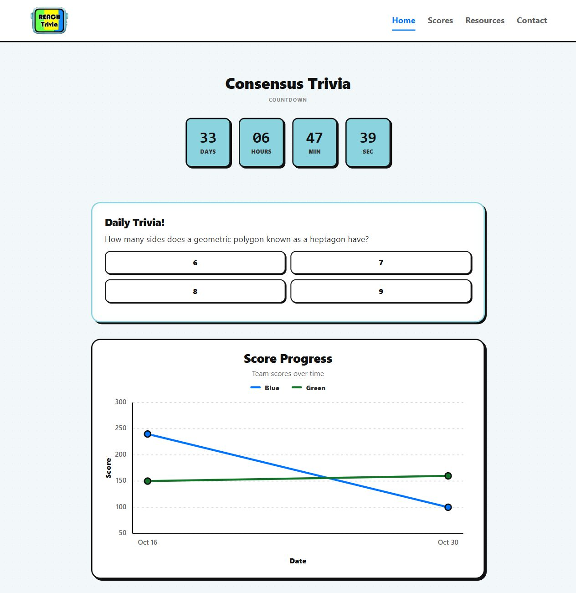
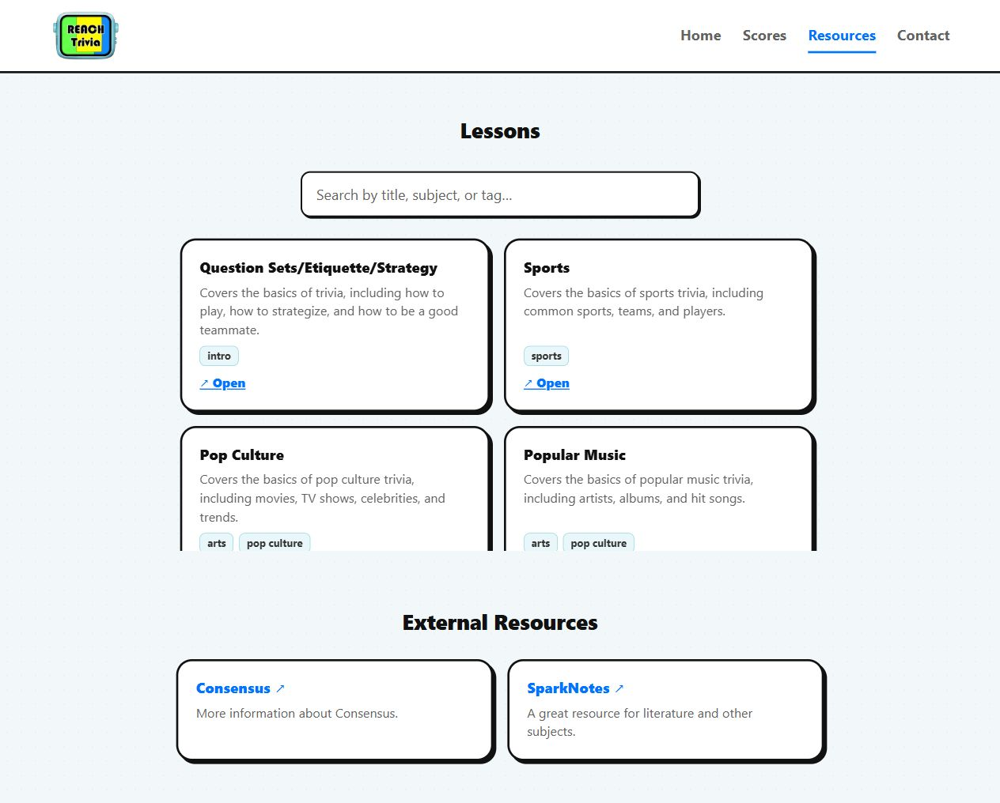

# Reach Trivia

The website for Earl Haig's trivia club. Daily questions, lesson slides, live
match scores, and a place to find the club.

**[Visit the website →](https://reachtrivia-ehss.vercel.app/)**



<details>
<summary>Lessons page</summary>



</details>

## Updating the site

| What you're changing                                | Where to edit                                           |
| --------------------------------------------------- | ------------------------------------------------------- |
| Exec names, roles, meeting times, and contact links | [users.js](trivia-club/src/data/users.js)               |
| Past match scores                                   | [scoreHistory.js](trivia-club/src/data/scoreHistory.js) |
| Competition name and countdown date                 | [Home.jsx](trivia-club/src/pages/Home.jsx)              |
| Daily trivia questions                              | [questions.js](trivia-club/src/data/questions.js)       |
| Lesson descriptions and tags                        | [resources.js](trivia-club/src/data/resources.js)       |

New slides sync from the club's [Lessons folder](https://drive.google.com/drive/folders/17rkACr05l6Vu4b7GX7YFcyWZnnL3ATLQ).
Add the deck directly to that folder and make sure it's publicly viewable.
It should appear on the site within a few minutes.

Pushing changes to `main` triggers a Vercel deployment.

## Running locally

You'll need Node.js 22.13 or newer.

```sh
cd trivia-club
npm ci
npm run dev
```

Run `npm run check` and `npm run build` before pushing code changes.

## Passing it on

Before the next media master takes over, make sure they have access to the
GitHub repo, Vercel team, Drive folder, and the Google Cloud project used for
slide syncing. The Drive key stays in Vercel's production Secrets.

[Developer notes and deployment setup](trivia-club/README.md)
