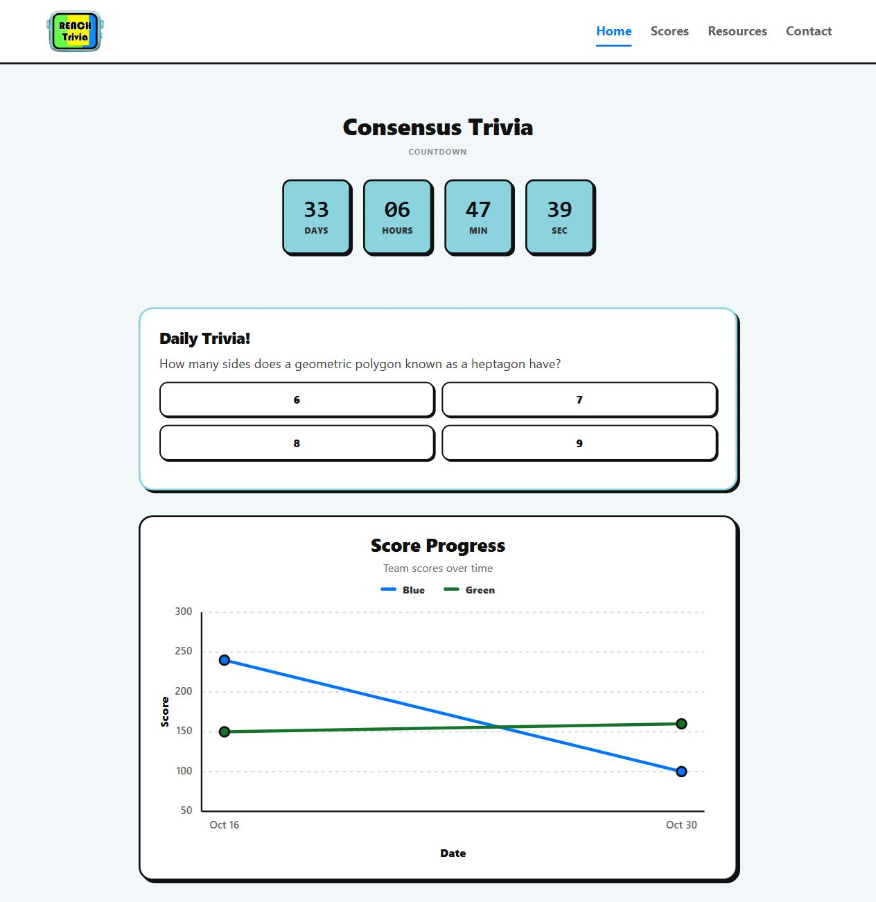
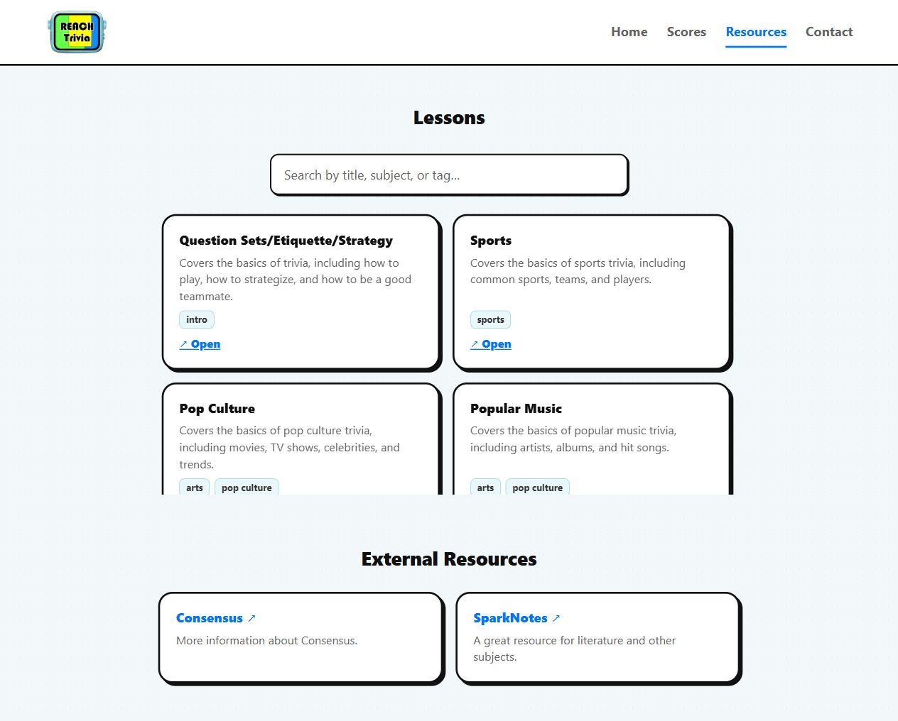

# Reach Trivia

The website for Earl Haig's trivia club. Daily questions, lesson slides, live
match scores, and a place to find the club.

**[Visit the website →](https://reachtrivia-ehss.vercel.app/)**



<details>
<summary>Lessons page</summary>



</details>

## Updating the site

| What you're changing                                | Where to edit                                           |
| --------------------------------------------------- | ------------------------------------------------------- |
| Exec names, roles, meeting times, and contact links | [users.js](trivia-club/src/data/users.js)               |
| Past match scores                                   | [scoreHistory.js](trivia-club/src/data/scoreHistory.js) |
| Competition name and countdown date                 | [Home.jsx](trivia-club/src/pages/Home.jsx)              |
| Daily trivia questions                              | [questions.js](trivia-club/src/data/questions.js)       |
| Lesson titles, links, and tags                      | [resources.js](trivia-club/src/data/resources.js)       |
| Question-set folder links                           | [questionSets.js](trivia-club/src/data/questionSets.js) |

Lesson links are maintained in the site data. To add a lesson, update
`trivia-club/src/data/resources.js` with its title, slide link, and subject tags.
Lesson search uses the titles and tags.

Pushing changes to `main` triggers a Vercel deployment.

## Running locally

You'll need Node.js 22.13 or newer.

```sh
cd trivia-club
npm ci
npm run dev
```

Run `npm run check` and `npm run build` before pushing code changes.

## Passing it on

Before the next media master takes over, make sure they have access to the
GitHub repo, Vercel team, and the linked Drive folders.

[Developer notes and deployment setup](trivia-club/README.md)

## Licence

The website source code is licensed under the GNU General Public License,
version 3 only. See [LICENSE](LICENSE). Linked slides, question sets, and
third-party materials retain their respective licences.
